<div align="center">
  <a href="https://github.com/Mylifeforrent/prompt-keeper">
    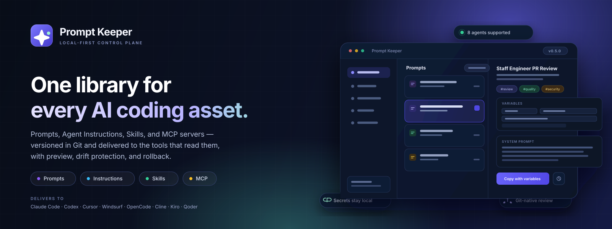
  </a>

  <p>
    
    
    
    
  </p>

  <h3>Your AI coding agents, finally on the same page.</h3>

  <p>
    Prompt Keeper is a <b>local-first desktop control plane for AI coding assets</b>.<br />
    Keep Prompts, Agent Instructions, Skills, and MCP servers in one versioned library,<br />
    share them through Git, and deliver each one to the tools that read it —<br />
    with preview, drift protection, and rollback.
  </p>

  <p>
    <a href="#quick-start"><b>Quick start</b></a> &nbsp;·&nbsp;
    <a href="#everything-in-one-library"><b>Features</b></a> &nbsp;·&nbsp;
    <a href="#how-it-works"><b>How it works</b></a> &nbsp;·&nbsp;
    <a href="docs/README.md"><b>Documentation</b></a>
  </p>
</div>

<p align="center">
  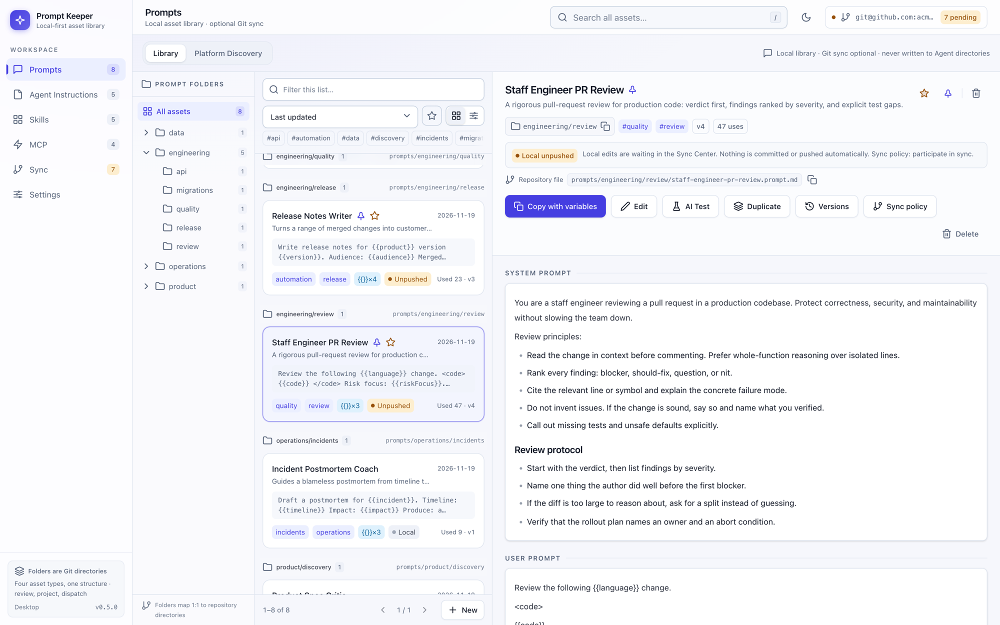
  <br />
  <sub>One library for four asset types — with folders, tags, variables, versions, and optional Git sync.</sub>
</p>

---

## The copy-paste tax ends here

Every agent wants its own copy. `AGENTS.md` for Codex. `CLAUDE.md` for Claude Code. `.cursor/rules` for Cursor. A Skills directory here. An MCP JSON file there. The same engineering rule is now in five places, and at least three of them have already drifted.

Prompt Keeper gives all four asset types one local home, one reviewable Git history, and one delivery layer. It is a desktop application because the job needs things a browser cannot do safely: write to agent directories, create symlinks, reuse system Git credentials, and protect secrets with the operating-system keychain.

What changes when you use it:

- **One library.** Prompts, Agent Instructions, Skills, and MCP servers share the same folders, tags, search, versions, and review model.
- **One source of truth.** Teams collaborate through a normal Git repository, with per-item review and three-way conflict resolution.
- **One delivery layer.** Each agent receives its native format at its own path — with a preview before the write and a record after it.
- **One security boundary.** Secrets stay on the machine, encrypted. Repository files contain placeholders only.

---

## Everything in one library

### Prompts — write once, render for the task

Write a prompt with `{{variables}}`, define the input types once, and copy a finished prompt for the task at hand. Every save is an immutable revision, and Copy with variables renders the final text and increments its usage count. Search, folders, tags, favorites, and pinning work across the whole library.

- Text, textarea, number, and select variables with required-field validation.
- Clipboard rendering with unresolved-variable warnings.
- Version history, diff review, and restore-as-new-version.
- Three sync scopes: inherit, sync with the repository, or keep local.

<p align="center">
  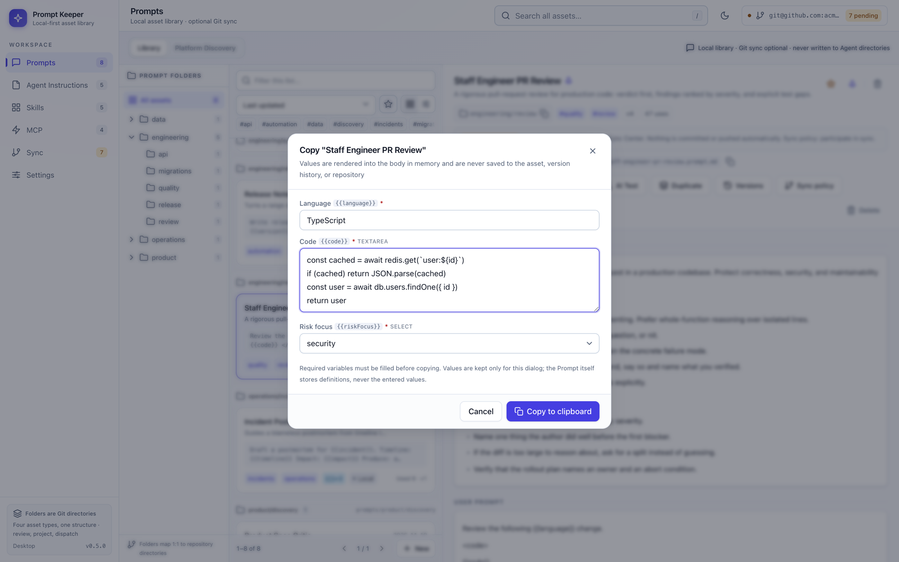
  <br />
  <sub>Fill typed variables instead of editing placeholders by hand; rendering and the clipboard write happen in the main process.</sub>
</p>

### Agent Instructions — one rulebook, compiled per tool

Contracts carry scope, activation, priority, imports, and target selection. The resolution preview shows exactly what an agent will read for a given file path: included contracts in order, skipped contracts with reasons, context-budget usage, and the compiled files that will be written.

Projection writes managed blocks or per-contract files, preserves everything outside the managed block, detects drift by hash, and rolls back from the previous version. Nothing is overwritten in bulk without confirmation.

- Six project targets: `AGENTS.md`, `CLAUDE.md`, GitHub Copilot instructions, Copilot path instructions, Cursor rules, and Windsurf rules.
- Eight global targets: Claude Code, Codex, Cursor, Windsurf, OpenCode, Cline, Kiro, and Qoder.
- Preview and write share the same pure compiler, so what you review is what lands on disk.

<p align="center">
  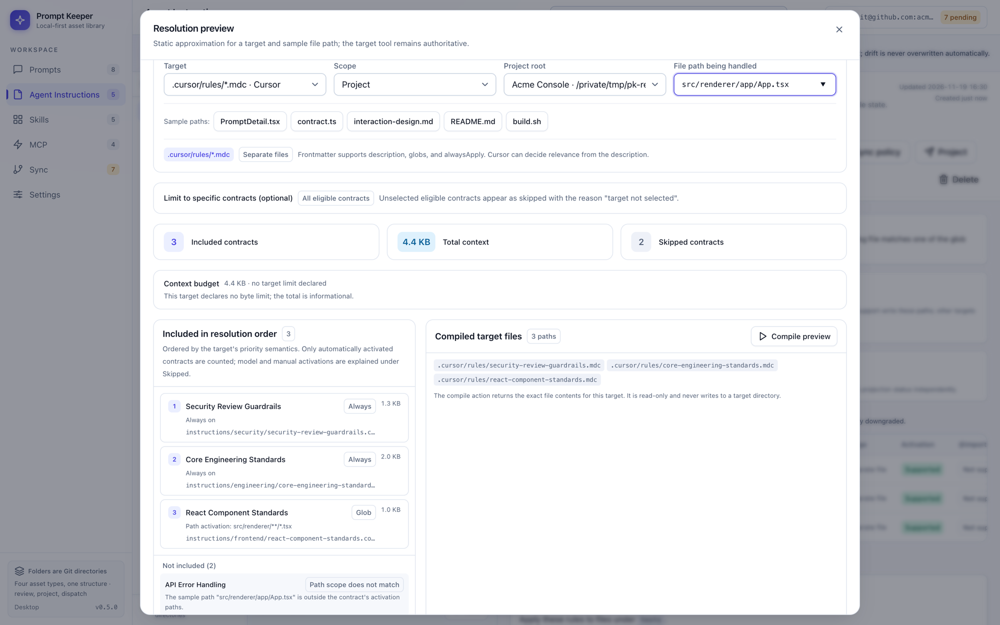
  <br />
  <sub>See the final rule set, the skip reasons, and the context cost before a single file is written.</sub>
</p>

### Skills — ship multi-file capabilities with a receipt

A Skill is a directory, not a single blob. Prompt Keeper stores `SKILL.md` plus supporting files, flags executables and scripts, and keeps immutable revisions over the complete file set. Install by symlink or copy into each agent's skill directory, then see real status per agent.

- Synced, stale, drifted, missing, and unsupported states in one view.
- Bulk sync only touches stale installs; drifted directories always require item-by-item review.
- Directory import shows the file list, risk findings, and script warnings before anything enters the library.
- Rollback restores the previous deployed version without touching the repository.

<p align="center">
  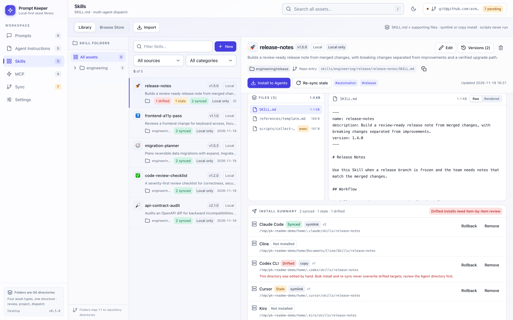
  <br />
  <sub>Every installed copy has a status, a path, a version, and a rollback.</sub>
</p>

### MCP — credentials stay on your machine

Repository MCP files contain `${VAR}` placeholders only. Real values are encrypted with Electron `safeStorage` and never enter Git, logs, audit events, diagnostics, error payloads, or renderer DTOs. The UI shows redacted credentials with `hasValue` instead of the value itself.

Apply a server to JSON, JSONC, or TOML agent configs with format-preserving managed entries. Unrelated keys and comments stay where they are. Existing servers can be imported in reverse from an agent configuration into encrypted storage.

- Static health checks without launching a process or opening a connection.
- Per-target redacted preview, drift reporting, and explicit placement acknowledgement.
- If OS encryption is unavailable, the app refuses to store the secret — there is no plaintext fallback.

<p align="center">
  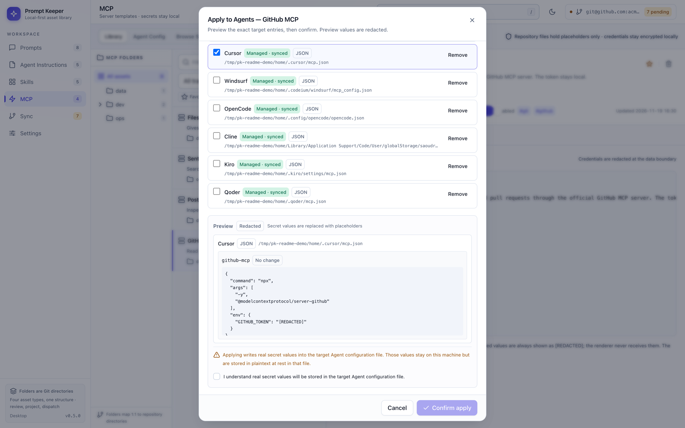
  <br />
  <sub>Placeholders in Git. Encrypted values locally. A redacted preview before every apply.</sub>
</p>

### Sync — review first, never auto-merge

Git is the shared source of truth, but Prompt Keeper never treats it as a remote-control button. Fetch is read-only. Each incoming change gets a per-item review with redacted three-way content. Pull applies only what you reviewed and revalidates fingerprints before writing.

- Added, modified, deleted, and renamed assets tracked by stable ID.
- Three-way conflicts with take-repository, keep-local, or manual merge.
- High-confidence credential findings block a push and return masked previews only.
- Direct or branch push modes. No force, amend, rebase, auto-commit, or auto-push.
- Every fetch, pull, push, review, conflict, projection, dispatch, and rollback lands in the audit trail.

<p align="center">
  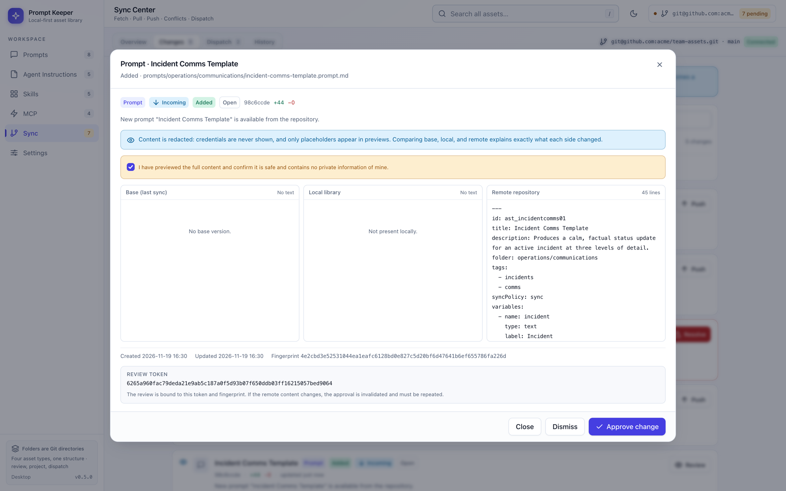
  <br />
  <sub>Review each change. Pull only what you approved. Resolve conflicts explicitly.</sub>
</p>

<p align="center">
  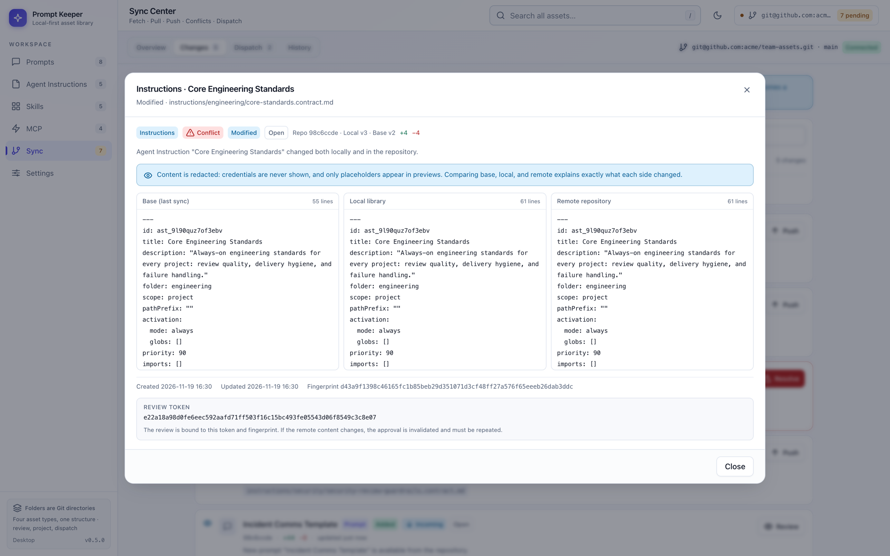
  <br />
  <sub>Base, local, and remote side by side. A conflict is never resolved silently.</sub>
</p>

### Dispatch — see every delivery in one matrix

The Sync Center's dispatch matrix shows every Skill and MCP server across every detected agent. Re-sync stale cells in bulk. Drifted cells stay red and require a human decision; batch operations never overwrite hand-edited agent directories.

<p align="center">
  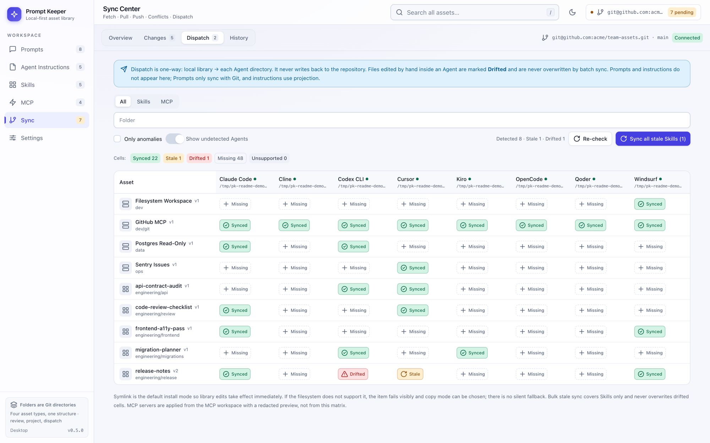
  <br />
  <sub>One grid for all installed assets, all agents, and all drift.</sub>
</p>

---

## How it works

<p align="center">
  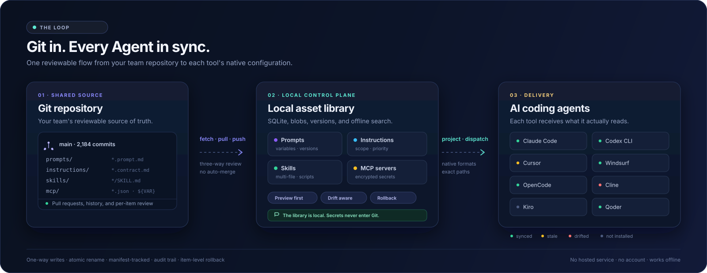
</p>

Git is the **shared** source of truth. The local library is the **operational** source of truth. Agent directories are **delivery targets** — never the other way around.

1. **Connect a repository.** Point at a local Git worktree and the app reads its `origin` and branch, reusing your existing Git credentials with no token. A managed clone from a remote URL is also available. Either way, a two-phase connection previews layout detection, asset counts, malformed files, duplicate IDs, scripts, and credential findings before writing anything.
2. **Curate locally.** SQLite indexes the library; content-addressed blobs store revisions; full-text search stays on the machine.
3. **Deliver with intent.** Projection for instruction contracts, symlink or copy for Skills, format-preserving merge for MCP — every write previewed, tracked, and reversible.

<p align="center">
  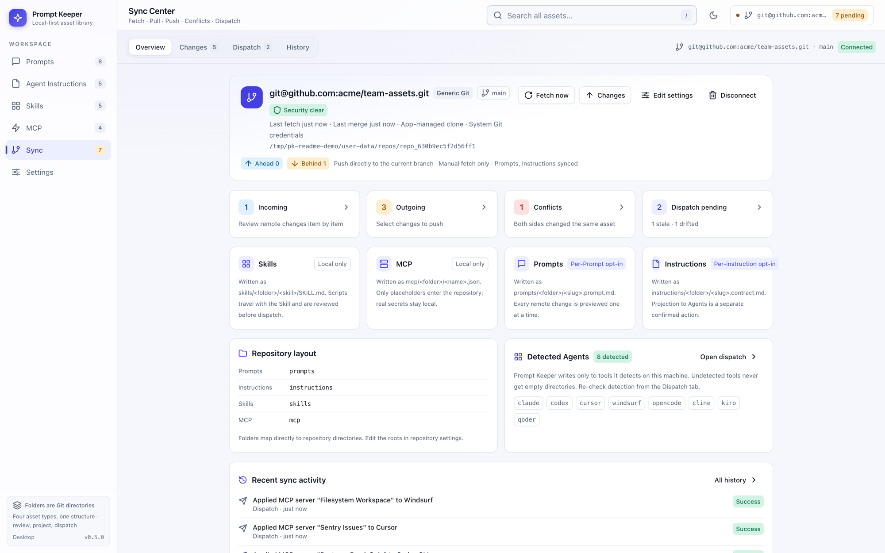
  <br />
  <sub>Repository state, pending review, sync policy, and detected Agents in one screen.</sub>
</p>

### What each asset type can do

| Asset | Canonical repository form | Delivery |
| --- | --- | --- |
| Prompt | `prompts/<folder>/<slug>.prompt.md` | Local library and optional Git sync only |
| Agent Instructions | `instructions/<folder>/<slug>.contract.md` | 6 project targets and 8 global targets |
| Skill | `skills/<folder>/<skill-name>/SKILL.md` plus files | 8 agent skill directories, symlink or copy |
| MCP server | `mcp/<folder>/<server-name>.json` | 8 agent configuration files, JSON/JSONC/TOML |

---

## Security is the architecture

Prompt Keeper is local-first by construction, not by configuration.

- **No hosted service and no account.** There is no HTTP server, no tenancy, and no asset upload. Core workflows run offline.
- **Secrets never leave the machine.** MCP values are encrypted with the OS secret store; DTOs expose `[REDACTED]` and `hasValue`.
- **Writes are constrained and atomic.** Every target path resolves from a main-process record to an allowed root. External writes use temp-file plus atomic rename with retries.
- **Drift is never bulk-overwritten.** Skills, projections, and MCP entries require item-level confirmation after hand edits.
- **Nothing downloaded is executed.** Skill scripts, MCP commands, package managers, and repository hooks are never run by the app.
- **The renderer is untrusted.** Sandboxed renderer, context isolation, strict CSP, no Node integration, and validated IPC payloads. Markdown from repositories or AI content is sanitized.
- **Actions are auditable.** Projections, dispatches, syncs, conflicts, backups, and restores produce audit events that carry IDs, never content or secrets.

<p align="center">
  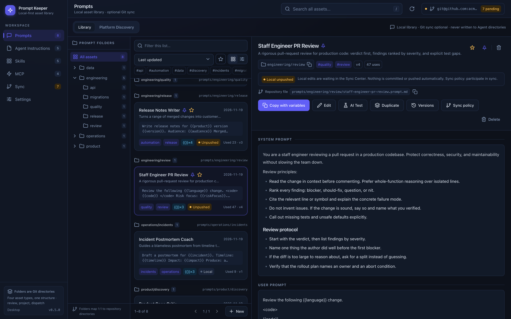
  <br />
  <sub>Light, dark, and system themes. Same dense desktop layout, same local data.</sub>
</p>

### Designed for the way you already work

- **Solo developers** stop re-pasting the same prompt and rules into every new tool.
- **Teams** get one reviewable repository instead of five private copies of the truth.
- **Platform and DX teams** can standardize Skills and MCP servers, then prove which version reached which agent.

Keyboard-first: `/` focuses global search, `N` opens the create flow for the current asset type, and `Esc` closes overlays.

---

## Works with the agents you use

| Project instructions | Global instructions | Skills | MCP |
| --- | --- | --- | --- |
| `AGENTS.md` | Claude Code | Claude Code | Claude Code |
| `CLAUDE.md` | Codex CLI | Codex CLI | Codex CLI |
| GitHub Copilot | Cursor | Cursor | Cursor |
| Copilot path instructions | Windsurf | Windsurf | Windsurf |
| Cursor rules | OpenCode | OpenCode | OpenCode |
| Windsurf rules | Cline | Cline | Cline |
| — | Kiro | Kiro | Kiro |
| — | Qoder | Qoder | Qoder |

The target registry is data-driven. Adding a target means adding an entry plus contract tests — not a new workspace.

---

## Quick start

### Run from source

Requires **Node.js 20+**, **npm**, and **system Git**. macOS 13+ and Windows 10 21H2+ are supported for the packaged product.

```bash
git clone https://github.com/Mylifeforrent/prompt-keeper.git
cd prompt-keeper
npm install
npm run rebuild      # rebuild better-sqlite3 for the installed Electron ABI
npm run dev          # launch the app with renderer hot reload
```

### Verify and package

```bash
npm run build            # TypeScript check + production build
npm test                 # Vitest inside Electron's Node runtime
npm run test:e2e         # Playwright Electron flow (run npm run build first)
npm run package:portable # macOS .app zip + Windows portable .exe
```

Portable builds land in `release/`. They are ad-hoc signed and not notarized, so macOS may require right-click → Open and Windows SmartScreen may warn on first launch.

<details>
<summary><b>All commands</b></summary>

```bash
npm run build        # tsc --noEmit + electron-vite build
npm run start        # preview the production build
npm test             # unit + integration tests in Electron's Node runtime
npm run test:unit
npm run test:integration
npm run test:e2e
npm run package:mac      # macOS zip (arm64 + x64)
npm run package:win      # Windows portable .exe (x64)
npm run package:portable # both portable formats
npm run rebuild          # rebuild better-sqlite3 for the current Electron ABI
```

`npm test` uses Electron's Node runtime so `better-sqlite3` loads with the ABI it was rebuilt for. If the native module fails to load after an Electron upgrade, run `npm run rebuild`.

</details>

---

## Architecture

```text
src/main/       Electron main process: services, SQLite, blobs, Git, filesystem, safeStorage
src/preload/    Narrow typed IPC bridge; no business logic
src/renderer/   React renderer; no Node.js, filesystem, Git, or secrets
src/shared/     IPC contract types, channel catalog, pure domain logic
```

- `src/main` is the only writer of SQLite, blobs, the library, Git clones, agent directories, and project roots.
- The renderer sends asset IDs, target IDs, selections, and content payloads — never arbitrary write paths and never stored secret values.
- Preview and write share the same pure compiler in `src/shared/domain`.
- `src/shared/contracts/`, `bridge.ts`, and `channels.ts` mirror [`docs/api-contract.md`](docs/api-contract.md).
- Sync never auto-commits, auto-pushes, auto-merges, or auto-writes to an agent directory.

<details>
<summary><b>Repository layout</b></summary>

```text
src/main/                     Electron main process: services, adapters, SQLite, operations
src/preload/index.ts          Typed IPC bridge
src/renderer/app/             App shell pieces and navigation types
src/renderer/components/      Reusable layout, shared components, and UI primitives
src/renderer/features/        Workspaces: prompts, instructions, skills, mcp, sync, settings
src/renderer/lib/             IPC client, query keys, formatting, view models
src/shared/contracts/         IPC DTOs
src/shared/channels.ts        Channel catalog
src/shared/domain/            Pure domain modules
assets/                       README brand assets and product screenshots
scripts/                      Build, test, and README capture tooling
design/prototype/             Frozen design prototype (not shipped)
tests/unit/                   Domain tests
tests/integration/            SQLite, blob, and asset tests
tests/e2e/                    Playwright Electron tests
docs/                         Product and technical documentation
```

</details>

<details>
<summary><b>Data locations</b></summary>

All application data lives under Electron's `userData` directory. On macOS that is `~/Library/Application Support/Prompt Keeper`; on Windows it is `%APPDATA%\Prompt Keeper`.

| Data | Path |
| --- | --- |
| SQLite database | `<userData>/db/prompt-keeper.sqlite` |
| Content blobs | `<userData>/blobs/<aa>/<bb>/<sha256>` |
| Materialized library | `<userData>/library/<kind>/<asset-id>/` |
| Managed Git clones | `<userData>/repos/` |
| Backups | `<userData>/backups/` |
| Logs | `<userData>/logs/` |
| Operation journal | `<userData>/operations/` |

</details>

<details>
<summary><b>Canonical repository formats</b></summary>

```text
prompts/<folder>/<slug>.prompt.md
instructions/<folder>/<slug>.contract.md
skills/<folder>/<skill-name>/SKILL.md      # plus supporting files
mcp/<folder>/<server-name>.json
```

Folders map directly to repository directories and may be nested. MCP repository files contain only `${VAR}` placeholders for credentials:

```json
{
  "id": "ast_mcp",
  "title": "GitHub server",
  "folder": "dev",
  "transport": "stdio",
  "command": "npx",
  "args": ["-y", "@modelcontextprotocol/server-github"],
  "env": {
    "GITHUB_TOKEN": "${GITHUB_TOKEN}"
  },
  "enabled": true
}
```

Full frontmatter and file schemas: [`docs/interaction-design.md`](docs/interaction-design.md) and [`docs/backend-design.md`](docs/backend-design.md).

</details>

---

## Documentation

| Document | Purpose |
| --- | --- |
| [`docs/README.md`](docs/README.md) | Documentation index, authority order, and reading paths |
| [`docs/prd.md`](docs/prd.md) | Product requirements, scope, priority, and release criteria |
| [`docs/architecture.md`](docs/architecture.md) | Electron process model, storage, sync, dispatch, and security |
| [`docs/frontend-design.md`](docs/frontend-design.md) | Renderer architecture and feature design |
| [`docs/backend-design.md`](docs/backend-design.md) | Main-process services, schema, Git engine, and projection algorithms |
| [`docs/api-contract.md`](docs/api-contract.md) | Binding IPC channels, DTOs, errors, events, and concurrency rules |
| [`docs/interaction-design.md`](docs/interaction-design.md) | UX and domain behavior source of truth |
| [`docs/implementation-status.md`](docs/implementation-status.md) | What is implemented, simplified, or deferred |
| [`docs/business-model.md`](docs/business-model.md) | Business model draft and commercial hypotheses |

The renderer–main boundary is [`docs/api-contract.md`](docs/api-contract.md); channel names and payload shapes in `src/shared` mirror it.

---

## Status

The desktop MVP is implemented: Electron shell, SQLite and blob storage, all four asset workspaces, instruction projection, Skill dispatch, MCP secret handling and application, Git synchronization, settings, backups, diagnostics, and automated tests.

Code signing, notarization, auto-update feeds, hosted catalogs, and team features are intentionally out of scope for this phase. See [`docs/implementation-status.md`](docs/implementation-status.md) for the exact boundary.

Product screenshots in this README are captured from the running desktop app with an isolated demo library; the repository, agents, and servers shown are examples. On macOS, regenerate them with `node scripts/capture-readme-screenshots.mjs` after `npm run build`.

## License

MIT. See [`LICENSE`](LICENSE).

<p align="center">
  <sub>Built for developers who use more than one AI coding agent.</sub>
</p>
